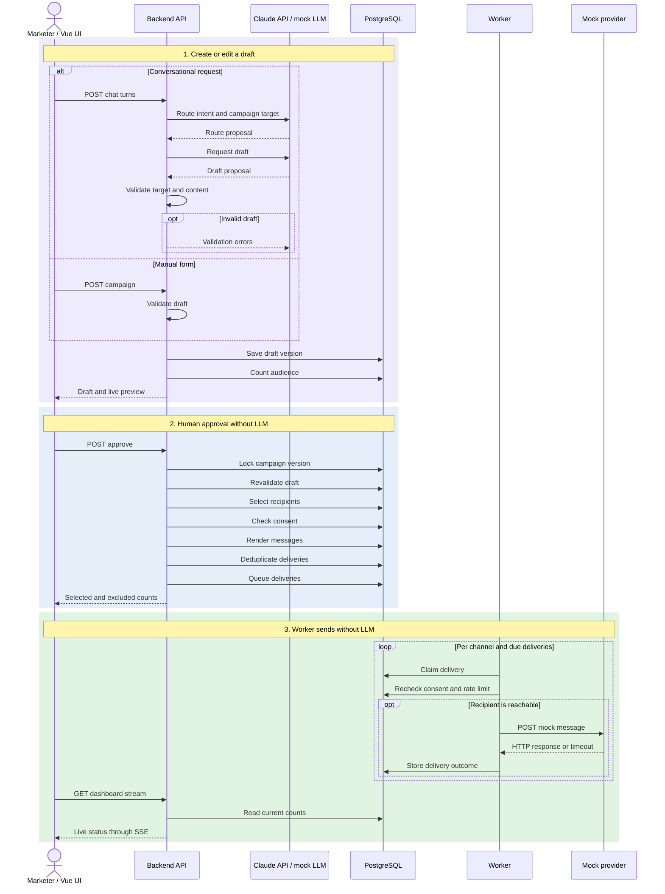

# Smart Campaign Composer

A campaign tool that turns a marketer's natural language brief into an audience rule and SMS/email drafts, asks for human approval, then sends to a mock provider and shows live delivery status. No real recipient receives a message.

The reasoning behind the design, with its trade-offs and limits, is in [DECISIONS.md](DECISIONS.md).

## Quick start

Docker is the only local prerequisite; Go and Node are not required.

```sh
make up        # Build and start the application
# UI and API:             http://localhost:8080
# Mock provider stats:    http://localhost:8090/stats
# Worker metrics:         http://localhost:9091/metrics
make demo-data # Add six weeks of sample campaign history once
make logs      # Follow API, worker, and mock provider logs
make down      # Stop services and keep their data
make reset     # Stop services and delete database and provider data
```

Use `make demo-data` to populate a fresh installation. It creates 15 campaigns in six chats: 14 approved on different days over the previous six weeks and one draft awaiting approval. The history includes marketer briefs, draft versions, and recipients excluded at approval because of missing consent or duplicate content. Drafts and approvals go through the application's normal code with a historical clock. Messages are marked `mock · demo-history`. Audience rules read recipients' current order totals, spending, and language preferences; sign-up dates and behavioral events are evaluated relative to each historical approval time.

The historical messages are sent by the real worker to the mock provider, using the normal channel limits and retry rules. Provider responses determine whether each delivery is `sent`, `failed`, or `unknown`. The command waits for delivery to finish, usually one or two minutes, then shifts recorded completion times back to each campaign's approval day while preserving the intervals between results. These shifted timestamps do not represent provider call start times; the 100 calls/second channel limit applies during the actual run. Provider acceptances remain in its own log. Because an `unknown` delivery may have been accepted, `/stats` can show more acceptances than the database shows `sent` deliveries.

The default `MOCKPROVIDER_FAULTS` has no permanent `reject_400` response, so failures may be rare. To see permanent failures, set, for example, `MOCKPROVIDER_FAULTS=reject_400=0.02,reject_429=0.02,fail_503=0.01,accept_then_503=0.01,accept_then_drop=0.005,delay=0.01` in `.env` and reload the stack.

The app drafts with Claude: copy `.env.example` to `.env`, set `ANTHROPIC_API_KEY`, and optionally `LLM_PROVIDER=anthropic`. The live runs described under [Scope and limitations](#scope-and-limitations) used `LLM_MODEL=claude-sonnet-5-5`. Without a key, the app uses a scripted demo model and displays a persistent “MOCK LLM: Claude'a bağlı değil” (“not connected to Claude”) banner. Message badges and the approval dialog also identify mock-generated drafts. With `LLM_PROVIDER=anthropic`, the API refuses to start unless a key is present.

| Service           | Responsibility                                                                              |
| ----------------- | ------------------------------------------------------------------------------------------- |
| `postgres`        | Application data and delivery queue                                                         |
| `migrate`, `seed` | Apply the schema and load fake recipients into an empty database, then exit                 |
| `api`             | REST and SSE API, Vue UI, `/metrics`, `/readyz`, and recovery of interrupted turns          |
| `worker`          | Send approved deliveries within shared channel limits                                       |
| `mockprovider`    | Fake SMS/email provider with durable acceptances and configurable faults and response delay |

The same image provides the `api`, `worker`, `mockprovider`, `migrate`, `seed`, `history`, and `probe` commands. Configuration comes from environment variables; examples are in `.env.example`.

## Architecture

The frontend uses Vue 3 and TypeScript. The API and worker are written in Go, and PostgreSQL 17 stores both application data and the delivery queue. The Claude adapter uses `anthropic-sdk-go/v2`. Select the model with `LLM_MODEL` (default: `claude-opus-5-5`). The LLM can propose drafts; it cannot approve or send campaigns.



The conversational flow has seven steps:

1. **Brief.** The marketer writes a natural language request. A turn runs on the server, survives a dropped browser connection, and is deduplicated by client turn ID.
2. **Routing and draft proposal.** A router model proposes the intent and target campaigns. The backend verifies that targets belong to the chat and are editable drafts; uncertainty produces a clarification question. For create or edit requests, the main model proposes a name, JSON audience rule, channel content, and optional language variants. The name, SMS text, and email subject and body appear in the live preview while the model writes the draft, one field at a time: the draft tool runs without `eager_input_streaming`, so the API checks each tool parameter before sending it, and the email's subject and body arrive together.
3. **Validation.** The backend strictly parses tool input and validates catalog fields, events, locations, content limits (160 characters for SMS; 80 for email subjects), personalization variables, language settings, and the base version. Validation errors are returned to the model for repair. The third round in which every proposal is rejected ends the turn; a round that saves a draft does not count. Valid proposals create a new version and receive an audience count.
4. **Version-specific approval.** “Onayla ve gönder” (“Approve and send”) submits the displayed version ID to `POST /api/campaigns/{id}/approve`. The backend locks the campaign, rejects a stale version with `409 stale_version`, revalidates the draft, selects recipients against current data, and renders each personalized message. Unresolved language decisions prevent approval. A single transaction inserts deliveries; approved versions cannot be edited. Optional `scheduled_at` defers delivery without deferring approval. For A/B drafts, language is resolved before the recipient's arm is selected.
5. **Queue.** The `deliveries` table is the queue. Workers claim only due rows (`next_attempt_at`) with `FOR UPDATE SKIP LOCKED` and a time-limited lease, so concurrent workers cannot claim the same delivery. Each delivery ID becomes its `Idempotency-Key`.
6. **Mock delivery.** The provider records acceptances but sends nothing externally. It can return 429, 400, or 503; delay a successful response; or accept a message and lose the response. The worker classifies each attempt as accepted, definitely not sent, or uncertain. A definite 4xx rejection other than 408 or 429 is not retried. Other retryable outcomes get at most five attempts with increasing randomized waits between one second and one minute.
7. **Live tracking.** Overview, campaign list, and campaign detail views refresh through `/api/dashboard/stream`. Approved campaigns in the assistant also use `/api/campaigns/{id}/stream`. These SSE streams publish updated counts once per second.

### Model authority

The router has only the `route_request` tool. The main model can call `save_campaign_draft` and `remove_ab_test`; it has no approval or sending tool. Omitting `ab_test` from an edit does not delete an existing B arm: the backend preserves B or rejects an incompatible edit and asks the model to update it. The model supplies a JSON audience rule, never executable SQL. The backend compiles the rule from an allowlisted catalog into parameterized SQL and applies a query timeout. Tool results expose validation issues or audience counts. Sending starts only after the approval endpoint is called.

### Consent, deduplication, and rate limiting

| Rule              | At approval                                                                                                                                                               | At delivery                                                                                                                                                          |
| ----------------- | ------------------------------------------------------------------------------------------------------------------------------------------------------------------------- | -------------------------------------------------------------------------------------------------------------------------------------------------------------------- |
| **Consent**       | Exclude recipients without consent or contact details for the channel.                                                                                                    | Recheck both immediately before each provider call; if revoked, skip the delivery.                                                                                   |
| **Deduplication** | The partial unique index `ux_deliveries_message` prevents a second queued delivery with the same recipient, channel, and hash of rendered content, even across campaigns. | Retry uncertain attempts with the same `Idempotency-Key`; the provider returns its original acceptance instead of accepting the message twice.                       |
| **Channel rate**  | No provider call occurs.                                                                                                                                                  | Each call needs a PostgreSQL `grant_call()` grant. All workers share the default limit of 100 calls per second per channel, including retries, and share 429 pauses. |

An `unknown` outcome retains the deduplication claim because the provider may have accepted the message. Only definitely unsent `failed` or `skipped_no_consent` outcomes release it. Scheduled campaigns use the same rules: content and recipients are fixed at approval, while consent is rechecked at send time. A/B arms have distinct content and therefore distinct deduplication hashes.

## Scope and limitations

- **The demo model does not understand natural language.** Without an API key, or with `LLM_PROVIDER=mock`, it plays scripted responses selected by `#scenario:` tags. This exercises backend validation, repair, persistence, approval, and delivery, but does not measure prompt quality.
- **Live Claude runs are a smoke test, not an evaluation.** On 2 November 2026, with `claude-sonnet-5-5` on a fresh stack with the 5,000 seeded recipients:
  - One chat went through the whole chain through the API: a create, an edit ("shorten the SMS, add the code SEPET10 to the email"), a second campaign for Ankara, and an ambiguous request. Routing chose create (an empty chat needs no router call), edit, create, and clarify; the clarification wrote nothing. Every draft passed validation on its first call. The approved version went to the mock provider: 187 emails and 168 SMS sent, none failed or unknown, each message accepted once. The chat took nine model calls.
  - Four more turns ran in a browser, and the live preview filled in by field. In the run that timed it, the name, then the SMS, then the email subject and body appeared over about three and a half seconds before the draft was saved, and the reply text appeared at once at the end of the turn.
  - A turn that removes one channel from a campaign was replayed 15 times on a copy of the database, before and after the tool schema fix in [DECISIONS.md](DECISIONS.md) (decision 4).

  Prompt quality across many briefs, the language-variant and A/B flows with the live model, and `claude-opus-5-5` have not been measured. Automated tests use the demo model and local SSE fixtures and need no API key.

- **No real messages are sent.** Seeded recipients are fictitious; the worker sends only to `PROVIDER_URL=http://mockprovider:8090`.
- **There is no authentication.** Anyone who can reach the local API can create and approve campaigns. This is a local demo, not a deployment with user accounts or roles.
- **Mock provider delay is configurable.** The `delay` probability in `MOCKPROVIDER_FAULTS` defaults to 1%; `MOCKPROVIDER_DELAY` defaults to `200ms`. The provider records acceptance before delaying the response. `accept_then_drop` instead never sends a response and causes a client timeout.
- **All four optional features are implemented:** language variants (Turkish, English, French), scheduled sending, A/B variants, and GitHub Actions CI. Their limits are:
  - An approved scheduled campaign can be canceled before its send time while no delivery has started. Cancellation removes its pending deliveries and releases their duplicate-content claims. Rescheduling is not available. Its audience is frozen at approval; at send time only consent and contact details are rechecked.
  - A/B allocation is approximately 50/50 and supports only two arms. There is no winner selection or conversion metric; delivery outcomes are shown per arm, but Prometheus metrics are not split by arm.
  - Only `remove_ab_test` can remove an A/B test through chat. The model interprets the user's intent; the backend checks the target, version, and existing test.
  - The CI workflow has been checked locally with actionlint and the same `make` targets, but has not run on GitHub because the repository has no commit yet.

## Demo scenarios

In mock mode, append `#scenario:<name>` to a message or use the UI scenario selector. Without a tag, `default` plays the normal scenario: create a campaign in an empty chat, edit the selected draft, or ask which draft is meant when multiple drafts exist.

| Tag                     | Demonstrates                                                                         |
| ----------------------- | ------------------------------------------------------------------------------------ |
| `default`               | Normal create or edit flow (also used when no tag is present).                       |
| `repair`                | Backend rejects a 172-character SMS; the mock repairs it.                            |
| `unknown_city`          | An unknown city prevents saving and prompts a question.                              |
| `new_campaign`          | Create another campaign in a chat that already has campaigns.                        |
| `duplicate`             | Duplicate content is excluded at approval.                                           |
| `ambiguous`             | Router asks which campaign was intended.                                             |
| `refusal`, `max_tokens` | Refusal or one retry of a truncated response with a higher token limit.              |
| `save_then_llm_error`   | A saved draft survives a later model error; the turn is partial.                     |
| `error_mid_stream`      | A stream error saves nothing and offers “Tekrar dene” (“Retry”).                     |
| `slow_stream`           | A slow turn finishes on the server even if the page reloads or the connection drops. |
| `english`               | One English draft for everyone, with a Turkish chat reply.                           |
| `multilingual`          | Turkish, English, and French variants with country mappings.                         |
| `bilingual`             | Turkish and French variants; English recipients need a decision.                     |
| `group_decision`        | Resolve pending language groups separately.                                          |
| `pending_to_english`    | Assign all currently pending language groups to English.                             |
| `ab_test`               | Add a same-language B message to each A message while retaining A.                   |
| `remove_ab_test`        | Remove an A/B test with `remove_ab_test`, preserving audience and content.           |

The mock reads structured inputs but does not understand the brief. Its proposals pass through the same backend validation as Claude proposals.

## Interface and analytics

| KPI     | Meaning                                                                                                                               |
| ------- | ------------------------------------------------------------------------------------------------------------------------------------- |
| Sent    | Provider-accepted messages in the selected period (`sent_at`).                                                                        |
| Queued  | Deliveries pending, in progress, or awaiting retry now, regardless of date filter. Future scheduled deliveries are shown separately.  |
| Failed  | Deliveries definitely not sent in the selected period (`finished_at`).                                                                |
| Unknown | The provider may have accepted the message, but no conclusive response was received. It will not be sent again to the same recipient. |

- **Delivery chart:** Stacked SMS and email bars by day, or by hour for “Bugün” (“Today”). If only one day in the range has deliveries, a link opens its hourly view. Days use `APP_TIMEZONE` (default: `Europe/Istanbul`).
- **City chart:** Counts sent messages by the recipient's GeoNames city recorded at approval (top 10 on desktop, top five on mobile). Recipients without a city have a separate gray “unknown city” row, outside the ranking.
- **Recent requests and campaigns:** Show marketer briefs and outcomes. In mock mode, outcomes identify the prepared demo draft. Expanded campaign rows show channel counts and exclusions for missing consent or duplicate content.
- **Campaign detail:** Four KPIs, daily and city breakdowns since approval, exclusions, audience, and approved content.
- **Assistant:** Chat on the left and a draft workspace on the right, with audience and channel previews and a persistent “Onayla ve gönder” (“Approve and send”) action. Editing a name, rule, or message saves a new version. Unsaved changes block approval and chat submission until saved or discarded. “Manuel kampanya ekle” (“Add campaign manually”) adds a draft to the same chat; “Yeni sohbet” (“New chat”) starts an empty chat. Mobile switches between chat and draft views.
- **Manual creation:** “Yeni kampanya” (“New campaign”) opens `/campaigns/new` with manual and AI-assisted choices. The manual form sends no LLM request. It uses catalog-backed selectors for allowed fields, events, and locations instead of raw SQL or JSON. The backend validates the rule, counts the audience, and saves a `source=user` draft. Saving never starts delivery; the latest version still needs separate approval.
- **Scheduling:** The approval dialog offers “Hemen gönder” (“Send now”) or a future date and time. The UI interprets local device time and sends UTC to the API; storage is UTC. The date can be at most one year ahead.
- **A/B editing:** Each content variant has its own B message. B starts as a copy of A but cannot be saved unchanged. Preview and approval show both arms, including per-arm counts and sample messages; campaign detail shows delivery outcomes per arm.

Charts use ECharts 5.6 with SVG rendering and a table view. Relevant endpoints include `GET /api/analytics?range&channel&campaign_id&cities`, `GET /api/campaigns?id&status&q`, `GET /api/chats`, and `GET /api/requests?limit`.

`make up` applies pending migrations to an existing database. Migration `00002` backfills city and completion times; `00003` adds public UUIDs. Migrations `00006` (`scheduled_at`) and `00007` (`ab_test`, `ab_variant`, `approval_variants`) add columns without changing existing records.

## Observability and tests

- `GET /readyz` checks database access and schema version; pending migrations return 503. It reports which LLM provider is active and why mock mode was selected.
- `GET /metrics` (API) exposes turns, LLM calls, rejected drafts, repairs, delivery states, and approval exclusions.
- `GET :9091/metrics` (worker) exposes provider attempts, latency, rate-limit waits, and returned or reclaimed leases.
- `GET :8090/stats` (mock provider) exposes acceptances per key and message; a given recipient/channel/content combination should be accepted at most once through the app.

```sh
make test # Go race tests against PostgreSQL, frontend Vitest and vue-tsc; no API key needed
make lint # gofmt, go vet, and CI workflow validation with actionlint
```

Both commands run in Docker. `.github/workflows/ci.yml` runs them on pushes and pull requests without secrets.

## Location data

New audience rules target **countries or cities**, not administrative regions.

| Target             | Identifier           | Example                  |
| ------------------ | -------------------- | ------------------------ |
| Country            | ISO 3166-1 alpha-2   | `TR`                     |
| City or settlement | GeoNames `geonameId` | `745044` (İstanbul city) |

The catalog and user records also retain first-level administrative regions (for example `TR-34`, İstanbul province) for location context and compatibility. They are not selectable in new rules; the backend rejects a model-proposed province rule. A recipient without a city does not match a city target but can match a country target. The city chart likewise groups such recipients as “unknown city.”

The embedded catalog (`backend/internal/geo/catalog.json`) works offline. It contains 81 Turkish provinces as metadata, the seeded Turkish cities, and a small fixed set of foreign cities (including Paris in France and the US, and London in the UK and Canada). Adding a new targetable city requires a catalog update.

Country identifiers follow ISO 3166-1 alpha-2. Turkish province codes follow ISO 3166-2:TR (`TR-01` through `TR-81`). City identifiers come from [GeoNames](https://www.geonames.org), licensed under [CC BY 4.0](https://creativecommons.org/licenses/by/4.0/).

On 2026-10-27, the catalog's 24 city IDs were compared with the GeoNames `cities15000.txt` dump (34,189 records; latest change dated 2026-10-26). Every ID existed and its country code and name matched. This check did **not** verify each city's province assignment because GeoNames uses a different administrative-code system. To repeat the check after changing the catalog, download and extract [cities15000.zip](https://download.geonames.org/export/dump/cities15000.zip), then run:

```sh
make verify-geonames GEONAMES_DUMP=/path/to/cities15000.txt
```

Mismatches are reported as test failures. The dump can be kept under `local-data/`, which is ignored by Git.
